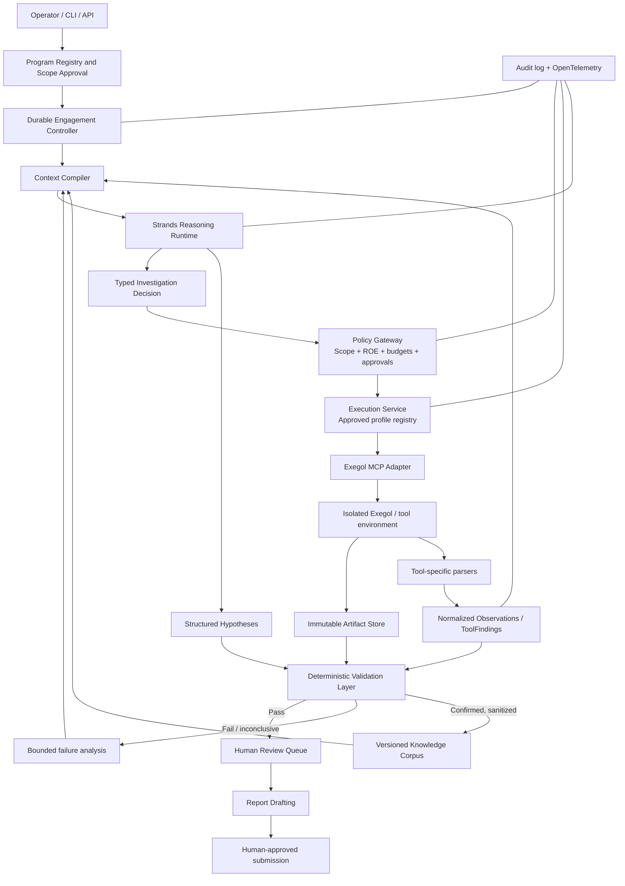

# Autonomous Bug-Bounty Engine
## Consolidated target architecture

**Architecture status:** Proposed baseline  
**Version:** 1.0  
**Date:** 28 October 2026  
**Primary stack:** Python, Strands Agents SDK, Exegol MCP, Pydantic, SQLite initially, content-addressed artifact storage

---

## Executive summary

Build a **controller-owned, policy-enforced security investigation system**. Use Strands to reason about evidence and propose bounded next steps; use Exegol MCP to access an isolated security-tool environment; and keep authorization, execution, durable state, validation, and submission decisions under deterministic application control.

The architecture combines three useful ideas from the supplied drafts:

1. **A deterministic scanning fleet** inspired by established recon workflows. Security tools run as bounded jobs and their outputs are normalized into typed findings.
2. **A Strands reasoning layer** for correlating weak signals, forming falsifiable hypotheses, choosing among approved investigation profiles, and reflecting on failed checks.
3. **An Exegol-backed execution boundary** that provides a contained tool environment without handing the model unrestricted shell access.

A fourth principle ties them together: **independent validation**. A model-generated hypothesis is not a vulnerability finding. Only evidence that passes scope, reproducibility, technical-oracle, severity, and deduplication gates can become a `ValidatedFinding`. A human approves live high-risk testing and every report submission.

Start with a modular Python monolith and one isolated Exegol execution environment. Do not begin with a swarm of agents, Kubernetes, a distributed event bus, or one microservice per package. Establish stable interfaces, reliable evidence handling, and low false-positive rates first; distribute components only when measured operational needs justify it.

## 1. Goals and non-goals

### Goals

- Run investigations only against assets and test types covered by current, explicit authorization.
- Use deterministic automation for routine discovery and signature detection, reserving expensive model reasoning for ambiguous or multi-signal cases.
- Keep raw tool output, evidence provenance, engagement state, budgets, and policy decisions outside the model conversation.
- Generate reproducible, evidence-backed findings with low false-positive and duplicate rates.
- Resume jobs safely after interruption without losing scope constraints or repeating side-effecting actions.
- Support a local lab / HTB learning mode and a production bug-bounty mode without mixing their authorization or memories.
- Make the model provider, tool runner, storage backend, and knowledge retrieval replaceable behind stable interfaces.

### Non-goals for the first release

- Unrestricted autonomous exploitation or arbitrary model-generated shell commands.
- Automatic report submission to HackerOne, Bugcrowd, or another platform.
- Destructive testing, denial-of-service, persistence, or actions that materially alter target state by default.
- Fine-tuning as the primary way to keep vulnerability knowledge current.
- Multi-agent swarm execution before a single-agent baseline is measured and dependable.
- Live-target testing in CI. CI uses mocks, replay fixtures, and deliberately vulnerable labs.

## 2. Architectural principles

1. **The application owns authority.** The LLM can recommend an action; it cannot grant its own permission, expand scope, change a budget, or approve a submission.
2. **Deny by default.** Every tool action passes deterministic policy checks immediately before execution. Missing, stale, ambiguous, or contradictory scope data means no action.
3. **Separate discovery, reasoning, and validation.** Tools discover; models hypothesize; independent validators establish evidence.
4. **Typed interfaces at every boundary.** Tool results, agent decisions, hypotheses, validation results, and reports use versioned Pydantic contracts.
5. **Evidence before narrative.** Reports are built from validated evidence references, not from the agent's confidence or prose.
6. **Untrusted target content stays data.** Target responses, banners, pages, files, and scanner output cannot act as instructions to the planner.
7. **Durable state is not chat history.** A database and immutable artifacts are the source of truth. Model sessions are disposable execution aids.
8. **Bound all loops and side effects.** Each job, model call, profile, retry path, and engagement has explicit time, step, concurrency, and cost limits.
9. **Measure before adding complexity.** New agents, tools, retrieval strategies, or reasoning budgets ship only when regression evaluations show an improvement.

## 3. System architecture



The diagram describes logical boundaries, not a requirement to run every box as a separate network service. In the initial deployment, the registry, controller, context compiler, Strands runtime, policy gateway, validation code, and persistence layer can live in one Python application. Exegol remains a separate execution boundary. A separate validation container is appropriate once the validator needs stronger isolation from the tool runner.

### 3.1 Component responsibilities

| Component | Owns | Must not own |
|---|---|---|
| Product interface | Create engagements, show progress, collect approvals, inspect reports | Direct tool execution or scope interpretation by itself |
| Program registry | Signed-off scope, exclusions, ROE, rate limits, authorization window, policy version | Model-generated permission changes |
| Engagement controller | Durable states, scheduling, checkpoint/resume, cancellation, retries and budget reservations | Deciding that a target is authorized based on LLM prose |
| Context compiler | Build a compact, task-specific context packet from trusted records and evidence | Changing scope or treating chat history as the source of truth |
| Strands runtime | Analyze supplied evidence and return typed hypotheses / next-action proposals | Direct unrestricted execution or final validation authority |
| Policy gateway | Deterministic checks before every action; approval and budget enforcement | Relying on model confidence or natural-language promises |
| Execution service | Resolve approved profile IDs into fixed, reviewed operations | Accepting arbitrary commands or arbitrary targets from the model |
| Exegol adapter | Invoke permitted Exegol MCP operations, collect results, handle timeouts | Exposing the full MCP surface directly to the reasoning agent |
| Scanning fleet | Run approved passive/active discovery and signature tools; normalize outputs | Importing model SDKs or holding model API credentials |
| Verification layer | Apply scope re-checks, reproduction policy, technical oracles, severity, deduplication | Trusting agent self-reported success |
| Evidence store | Immutable, hash-addressed raw artifacts and provenance | Silently rewriting evidence or mixing engagements |
| Knowledge layer | Retrieve tagged advisories, techniques, and sanitized confirmed outcomes | Treating similarity as proof or sharing tenant-specific data |
| Reporting | Draft reports from `ValidatedFinding` records and evidence references | Submitting without explicit human approval |

## 4. The investigation lifecycle

Represent the lifecycle as persisted states, not just a sequence of function calls.

1. **`CREATED`** — An operator creates an engagement and selects a mode.
2. **`SCOPE_PENDING`** — Scope terms, exclusions, allowed methods, rate limits, testing window, and reporting rules are ingested. An LLM may help extract candidate structure, but a human confirms the normalized `ScopeDocument` before any target execution.
3. **`READY`** — The signed-off policy is versioned and compiled into deterministic matchers and action permissions.
4. **`RECON`** — Permitted discovery profiles run in dependency order. Passive checks precede active checks where appropriate.
5. **`ANALYSIS`** — Parsers normalize output; the context compiler assembles relevant evidence; rules route obvious signatures and ambiguous hypotheses appropriately.
6. **`ACTION_PENDING`** — The agent proposes a typed action referencing a known target ID and approved profile ID. The policy gateway independently evaluates it.
7. **`WAITING_FOR_APPROVAL`** — The job pauses if the action requires human authorization, including any exploit-like test against a live asset unless explicitly pre-authorized by a reviewed policy.
8. **`EXECUTING`** — The execution service reserves budget, rechecks scope, invokes the profile through Exegol MCP, captures output, and records provenance.
9. **`VALIDATING`** — A deterministic gate pipeline determines whether the claim is supported, safely reproducible, in scope, and sufficiently evidenced.
10. **`HUMAN_REVIEW`** — A reviewer inspects the evidence and validation results. Rejected or inconclusive candidates are not reported as confirmed vulnerabilities.
11. **`REPORT_DRAFT`** — Report prose is derived from validated records and referenced artifacts.
12. **`SUBMISSION_PENDING`** — A human explicitly approves the final report and destination. The platform connector, if enabled, may prepare or submit only the approved content.
13. **`CLOSED`** — The engagement is complete and its audit/evidence trail is retained under the configured retention policy.

`BLOCKED`, `CANCELLED`, and `FAILED` are terminal or recoverable states with explicit reason codes. Every transition is checked, persisted, and auditable. Restarting a process resumes from durable state; it must not assume that a model session is intact.

## 5. Three-layer investigation design

### Layer A — Deterministic discovery and detection

This is a bounded workflow / DAG outside the model loop. Use established recon tools and patterns rather than building every scanner from scratch. The application owns scheduling, dependency order, concurrency, rate limits, allowlists, and cancellation. Each tool has a versioned profile and a parser with replayable unit tests.

| Workstream | Typical role | Enablement rule |
|---|---|---|
| Passive OSINT | Certificates, known URLs, passive subdomain sources | Run first when permitted by the program policy |
| Active enumeration | DNS, ports, service fingerprints | Only for explicitly in-scope assets and allowed rates |
| Web surface inventory | HTTP baselines, link discovery, bounded content enumeration | Scope-checked and throttled per program and host |
| Signature checks | Known vulnerability templates, TLS/configuration checks, common product checks | Template/version recorded; a hit is a candidate until its proof meets an oracle |
| CVE correlation | Compare fingerprints and versions with advisories | Version match is not enough by itself; reachability and applicability matter |
| Detect-only probes | Narrow fingerprint/detection checks | Off by default unless ROE permits them; never silently escalate to exploitation |
| Client artifact analysis | SAST, secret scanning, dependency and image analysis | Conditional on an authorized source/package/artifact being available |
| Binary / identity / AD analysis | Static binary analysis or permission-graph analysis | Separate engagement profiles for the relevant authorized environment; not part of the default web-bounty sweep |

Raw stdout, full page bodies, binary blobs, and scanner logs are written to the artifact store. Parsers create concise typed `ToolFinding` records containing a finding type, target ID, relevant signature/CVE, confidence category, artifact reference, tool version, and provenance. Do not dump raw scanner output into the model context.

A high-quality deterministic signature may bypass broad model hypothesis generation and go directly to the appropriate technical oracle. It does **not** bypass scope checks, evidence preservation, or final report review.

### Layer B — Strands reasoning

Use the **customizable Strands Agents SDK**, not a fully preassembled agent harness, as the runtime. The application should own its job lifecycle and action policy. Strands provides model calls, typed structured output, hooks, MCP interoperability where appropriate, and optional graph/specialist orchestration.

The first release should use a **controller-managed, single-agent loop**:

1. Load authoritative engagement state.
2. Build a fresh context packet for the current task.
3. Ask Strands for one typed decision or a set of falsifiable hypotheses.
4. Validate the schema and referenced IDs.
5. Pass the proposed action through the policy gateway.
6. Execute only the approved operation; record evidence and checkpoint state.
7. Resume with the new evidence, or pause for human review.

A Strands `Graph` can represent bounded in-run workflows where it adds clarity, but the durable application state machine remains authoritative. Set explicit step/time/token limits around every loop. Do not introduce `Swarm` or multiple autonomous specialists until evals show that specialist routing materially improves validated-finding quality. At that point, add narrow agents-as-tools for well-defined domains (for example web, cloud/identity, or binary analysis), all behind the same action policy.

#### Four deliberate reasoning checkpoints

| Checkpoint | Trigger | Purpose |
|---|---|---|
| Attack-chain synthesis | After a completed sweep and relevant knowledge retrieval | Connect separate signals into testable hypotheses that simple signatures miss |
| Failure reflection | After a validation or approved test fails | Explain likely gaps, identify the evidence that would distinguish alternatives, and avoid blind retries |
| Impact narrative | After a finding has passed technical validation | Draft a clear impact statement tied to demonstrated facts |
| Cross-engagement review | Periodic review of completed, sanitized outcomes | Suggest improvements to general playbooks and evaluation cases |

These checkpoints differ by prompt, model budget, and output schema—not by authority. The narrative or internal rationale is never accepted as proof. Persist structured rationale summaries, evidence references, model/prompt versions, and decisions for audit; do not treat private reasoning text as evidence.

#### Typed action proposals

The model should choose from a small closed set such as `inspect_inventory`, `run_approved_profile`, `review_evidence`, `request_human_review`, or `stop`. A proposal may reference a known `target_id`, `profile_id`, `hypothesis_id`, and supporting evidence IDs. It must not contain arbitrary shell commands, free-form target URLs to execute, self-selected budgets, or a field that can change authorization.

### Layer C — Independent verification

A candidate advances to `ValidatedFinding` only after a mostly deterministic pipeline succeeds:

1. **Scope re-check** — Confirm the target, method, time window, and authorization are still valid.
2. **Evidence completeness** — Check that the claim has preserved artifacts, timestamps, tool versions, and traceable provenance.
3. **Reproducibility policy** — Apply a bug-class- and side-effect-aware policy. Require repeated confirmation when safe and meaningful; never repeat a side-effecting action mechanically merely to satisfy a count.
4. **Technical oracle** — Run the fixed validator associated with the finding's proof archetype. The oracle should be independent of the generator's self-assessment.
5. **Severity** — Compute or recommend severity from demonstrated impact and documented scoring inputs; retain uncertainty where evidence is insufficient.
6. **Deduplication** — Compare asset, issue class, evidence fingerprints, and prior findings before creating a new report candidate.
7. **Human review** — Require reviewer approval before any report is submitted.

A model saying `likely_success` is telemetry only. A vulnerability name, scanner score, version match, or plausible explanation is not sufficient proof by itself.

#### Fixed proof-oracle taxonomy

Keep a small, closed set of proof types. `BugClass` identifies the canonical CWE and domain; the oracle archetype describes what kind of evidence can prove the claim. Do not conflate the vulnerability domain enum with the proof-oracle enum.

| Oracle archetype | Evidence pattern | Default considerations |
|---|---|---|
| `side_effect_execution` | A controlled action is demonstrably executed in an environment the tester controls | Require strong containment and explicit approval; avoid repeating side effects |
| `out_of_band` | An expected callback reaches infrastructure controlled by the tester | Correlate unique token, time window, and source evidence |
| `differential_statistical` | A measured response difference survives a defined, bounded comparison | Control noise and trial count; no unbounded probing |
| `state_change_authz` | A protected state transition occurs without the required authorization | Use test identities/data and reversible, approved scenarios |
| `content_match` | Response content matches an established expected artifact or secret pattern | Record exact provenance and minimize retained sensitive content |
| `crash_pov` | A replayable input consistently demonstrates abnormal execution | Use only in authorized lab/artifact contexts or under explicit safe rules |
| `graph_reachability` | A calculated permission path is verified edge by edge | Separate inferred edges from empirically confirmed edges |
| `cryptographic_proof` | A mathematical property is verified by a deterministic check | Save test inputs, outputs, algorithm assumptions, and verifier version |
| `component_match` | A component/version is in an affected range and the vulnerable component is relevant/reachable | A banner or version match alone is not a confirmed vulnerability |
| `availability_bounded` | Bounded, reversible availability impact is demonstrated | Disabled by default; require exceptional explicit ROE approval |

The taxonomy is intentionally stable; CWE/component/version metadata and evidence parameters vary. When a proof type cannot be safely or deterministically verified, the system should report the candidate as inconclusive for human review rather than manufacture a pass.

## 6. Context engineering and knowledge retrieval

Treat context assembly as a first-class subsystem. Every model call should receive a **fresh, compact, versioned context packet** compiled from durable state and the current task—not an ever-growing transcript.

### 6.1 Context packet order

1. **Non-negotiable instructions** — Role, allowed decision schema, and rule that evidence/target content is untrusted data.
2. **Authorization snapshot** — Program ID, policy version, in-scope asset IDs, exclusions, permitted profiles, rate limits, expiry, and approval state.
3. **Target brief** — Known asset inventory and technology fingerprints with source and confidence.
4. **Current objective** — What the current stage is trying to establish and what remains unknown.
5. **Evidence digest** — Concise typed observations, artifact IDs, contradictions, prior attempts, and current validation status.
6. **Relevant knowledge** — A small set of retrieved and tagged knowledge units filtered by CWE/domain, component, version range, oracle type, source, and freshness.
7. **Working memory / unresolved questions** — Prior decisions, failed hypotheses, and what evidence would discriminate among competing explanations.
8. **Budget and constraints** — Remaining calls, tool actions, wall-clock budget, per-host rate budget, and any pending approval.
9. **Required output contract** — Exact schema and valid IDs the model may reference.

The system prompt and authorization policy are not replaced by retrieved documents. Scope, exclusions, and budgets come from authoritative registry state; retrieved material can explain a technique but cannot authorize an operation.

### 6.2 Handling untrusted target content

Store raw responses and binary artifacts outside the prompt. A parser should emit typed fields and narrowly bounded excerpts when the excerpt is necessary to reason about a finding. Mark excerpts as untrusted data, quote/escape them, strip active formatting where possible, and never let them override system instructions. Include adversarial prompt-injection fixtures in evaluations. Treat tool output as evidence to parse—not instructions to follow.

### 6.3 Knowledge base layout

| Knowledge tier | Contents | Usage |
|---|---|---|
| Technique corpus | CWE / ATT&CK concepts, common false-positive patterns, proof limitations | Stable background guidance |
| Verification corpus | NVD/CVE data, vendor and GitHub advisories, curated scanner templates, relevant public technical references | Current component/version and proof parameter retrieval |
| Program policy | Current scope, exclusions, ROE, rate limits and reporting terms | Authoritative per-engagement policy; not cross-tenant shared |
| Episodic outcomes | Confirmed findings, failed/inconclusive validations, safe lessons from prior runs | Retrieve only when applicable; sanitize and tenant-isolate |
| Live engagement digest | Current sweep summary and hypotheses | Ephemeral context derived from this engagement |
| HTB / lab curriculum | Lab notes and known outcomes | Offline testing and tuning only; never treated as production authorization or proof |

Represent corpus entries as small, versioned `KnowledgeUnit` records with tags and a reference to the source artifact. Use hybrid retrieval: metadata filtering first, then semantic ranking. Retrieval is a hypothesis-generation aid; it never decides whether a validator passed. Only confirmed, sanitized outcomes may be promoted to general episodic knowledge. Keep program-specific findings, credentials, assets, and raw evidence tenant-isolated.

Start with a simple searchable store and a replaceable retrieval interface. Add a vector database only if evaluation shows it improves retrieval quality over metadata and lexical search. Re-ingestion should record source, version, fetch time, and content hash.

## 7. Exegol MCP execution boundary

Exegol provides the isolated security-tool environment; MCP is the transport/interface, not the policy layer. The application should implement `ExecutionService` and `ExegolAdapter` between the agent/controller and Exegol.

### Required execution path

`typed proposal → ID validation → policy gateway → budget reservation → fixed profile resolution → scope re-check → Exegol MCP call → artifact capture → parsing → durable checkpoint`

The agent must not receive unrestricted access to the full Exegol MCP tool surface. Some exposed operations may manage containers or run arbitrary commands; therefore:

- expose a narrow, reviewed set of operation/profile IDs to the application;
- map profile IDs to code-reviewed operations, arguments, deadlines, and resource limits;
- resolve hostnames and targets from the authoritative asset registry, not model-provided strings;
- do not pass model API credentials into scanner / Exegol containers;
- do not mount the host filesystem, Docker socket, or unrelated secrets into the tool container unless strictly required and explicitly reviewed;
- restrict network egress where possible, with enforcement outside the model;
- enforce per-host and per-engagement request rates, concurrency, output caps, and timeouts;
- capture exit status and output references even on failure; do not infer success from an exit code alone;
- treat redirects, discovered links, DNS changes, and newly observed hosts as candidates—not automatic scope expansion;
- require an explicit approval state for high-risk or exploit-like activity against live assets.

Docker/Exegol isolation does not replace program scope enforcement or network controls. Keep the Exegol endpoint configurable and local/private by default; verify the installed Exegol MCP version and endpoint semantics before implementation. Keep the HTB adapter separate from the production bounty adapter, and never allow an HTB job to inherit live bounty credentials or scope.

## 8. Core contracts and data model

Use Pydantic models in a dedicated `contracts` package. Treat contracts as public interfaces between packages and version them deliberately. Prefer stable IDs and references over copying large bodies across messages.

| Contract | Required meaning |
|---|---|
| `ScopeDocument` | Human-approved normalized policy: in-scope assets, exclusions, allowed methods, rate limits, time bounds, and program-specific constraints |
| `ScopeAsset` | A precisely typed asset matcher plus provenance and policy status |
| `ToolFinding` | One normalized scanner observation, with target ID, finding type, signature/CVE reference, deterministic confidence class, raw artifact reference, and tool provenance |
| `ToolSweepDigest` | Engagement-level summary of coverage and normalized findings, with omitted-output references |
| `BugClass` | Canonical CWE ID/name and domain, with an explicit mapping to an oracle archetype |
| `VulnerabilityHypothesis` | Falsifiable claim, supporting evidence IDs, CWE reference, rationale summary, confidence, and suggested specialist/profile category |
| `InvestigationDecision` | Closed action enum plus known target/profile/hypothesis/evidence IDs; no arbitrary command or scope mutation |
| `TestAttempt` | The approved profile, authorization decision, start/end times, result classification, evidence references, and side-effect classification |
| `ValidatedFinding` | Claim that passed required gates, oracle archetype, validated evidence, severity inputs, reproduction-policy result, and duplicate status |
| `KnowledgeUnit` | Tagged source reference with CWE, component/version, proof archetype, source, freshness, and content hash |
| `VulnerabilityReport` | Report draft built from validated evidence, impact statement, reproduction details, references, disclosure statement, and human approval metadata |
| `AuditEvent` | Who/what requested an action, policy version, decision, model/tool versions, timing, budget, and outcome |

All `*_ref` fields resolve to hash-addressed artifacts. Do not put secrets, session tokens, or large raw outputs directly in these contracts. A finding's confidence score is a routing/triage aid, never the validation oracle.

### 8.1 Evidence provenance

Every artifact should record, at minimum: SHA-256 content hash, engagement and asset IDs, acquisition time, source tool/profile and version, action/policy version, parent artifact IDs, exit status, redaction status, and storage location. Preserve raw output immutably; derived/sanitized artifacts get their own identifiers and parent links. Use idempotency keys for action requests so a retry after a crash cannot accidentally repeat an operation.

## 9. Persistence, audit, and operations

### Initial storage choices

- **SQLite** for the single-user MVP's engagement state, registry metadata, action ledger, hypotheses, validation state, and approvals.
- **Local content-addressed artifact store** for raw scanner output, response captures, logs, and evidence. Organize by hash, not a user-provided path.
- **PostgreSQL + object storage** when multi-user concurrent jobs, remote deployment, or operational requirements outgrow SQLite/local storage. Keep the interfaces stable so the migration is mechanical.
- **Versioned knowledge store** behind a `KnowledgeStore` interface; backend choice can change without changing contracts.

Use transactions for state transitions and budget reservations. Persist before/after action state, checkpoints, retries, cancellation, and authorization expiry. An action should be idempotent where possible; non-idempotent operations require explicit retry semantics.

### Audit and observability

Emit structured audit events and OpenTelemetry spans for every model call, policy decision, tool invocation, validation gate, approval, and report transition. Record correlation IDs across job → decision → action → artifact → finding. Track token/cost use, action latency, timeout rate, tool error rate, queue depth, and per-engagement budget. Protect audit data against accidental modification and apply retention/redaction rules to sensitive artifacts.

## 10. Repository and package boundaries

Use a `uv` workspace monorepo with separate packages for enforceable dependency boundaries, while deploying as one main application initially. Use Import Linter (or equivalent) to prevent scanning and verification code from importing model SDKs. Put package ownership and stricter review rules on the security-critical policy and verification directories.

```text
bounty-engine/
├── pyproject.toml                 # uv workspace, pinned dependency ranges
├── uv.lock
├── AGENTS.md                      # coding rules, trust boundaries, workflow checklist
├── CODEOWNERS
├── .importlinter
├── .env.example                   # names/placeholders only; never real secrets
├── Makefile                       # test, lint, eval, local integration
├── config/
│   └── defaults.toml
├── docker/
│   ├── exegol-execution/          # isolated tools; no model credentials
│   ├── verification/              # deterministic validation; no model SDK/creds
│   └── docker-compose.dev.yml
├── docs/
│   ├── architecture.md
│   ├── threat-model.md
│   ├── scope-and-approval-policy.md
│   ├── data-contracts.md
│   └── runbooks/
├── packages/
│   ├── contracts/                 # Pydantic schemas and closed enums
│   ├── governance/                # scope compiler/guard, approvals, budgets, audit
│   ├── persistence/               # registry, job state, checkpoints, idempotency
│   ├── evidence/                  # immutable artifacts, provenance, redaction
│   ├── scanning_fleet/            # DAG, tool profiles, parsers, sweep digest
│   ├── execution/                 # ExecutionService, profile registry, Exegol adapter
│   ├── verification/              # reproduction, scope gate, oracles, severity, dedup
│   ├── knowledge/                 # ingestion, metadata/semantic retrieval, episodic memory
│   ├── reasoning/                 # Strands runtime, routers, prompts, schemas
│   ├── reporting/                 # report synthesis, draft platform adapters
│   └── orchestrator/              # lifecycle, bounded workflow, CLI/API, checkpoints
├── evals/
│   ├── fixtures/                  # benign and adversarial target/tool-output samples
│   └── scorecard.py
└── tests/
    ├── unit/                      # package-level tests
    ├── integration/                # replay-based; no live target calls in CI
    ├── policy/                     # scope and approval invariants
    └── e2e_lab/                    # isolated, deliberately vulnerable fixtures
```

The directory names are boundaries, not a requirement for separate services. Keep package APIs small. Freeze mature interfaces through tests, changelog/version discipline, and protected review—not by making early implementation impossible to refactor.

## 11. Security controls and threat model

| Threat | Required control |
|---|---|
| Out-of-scope request from the model | Deterministic `ScopeGuard` before every action; known asset IDs only; deny on uncertainty |
| Scope changes or authorization expiry | Versioned signed-off policy; expiry check before execution and validation; revoke/cancel pending jobs on change |
| Indirect prompt injection in pages, banners, files, or tool output | Raw artifacts remain outside planner context; typed extraction, untrusted-data delimiting, adversarial eval fixtures |
| Exegol MCP offers too much capability | Narrow adapter, fixed profile allowlist, no direct unrestricted MCP access for the model |
| Tool runner compromise or escape | Least privilege, minimal mounts, no Docker socket where avoidable, egress restrictions, resource limits, patched images |
| Model/provider credentials leak to scanner | Secrets only in the control/reasoning environment; never in scanning or verification images |
| Repeated side effect after retry/restart | Idempotency keys, action ledger, explicit retry policy, human approval where required |
| False positive or fabricated impact | Independent deterministic oracle; evidence-required schema; human review; scorecard |
| Duplicate submissions | Deterministic and similarity-based dedup before reviewer queue |
| Cross-program information leakage | Tenant/program keys on all state and retrieval; sanitized opt-in promotion to general KB |
| Budget or tool loop runaway | Per-call/job/engagement/fleet limits; bounded retries; deadline and cancellation checks |
| Sensitive data in logs or reports | Redaction, access control, retention, artifact references, report preview before submission |

Two human gates remain permanent: **approval for exploit-like/high-risk actions on live assets** and **approval before every external report submission**. An explicit program policy may pre-authorize a narrowly defined class of low-risk profile; it cannot authorize the agent to expand that profile or its target set at runtime.

## 12. Evaluation and release gates

Maintain two different test suites:

- **Software tests:** unit, contract, policy, replay integration, recovery/idempotency, and isolated end-to-end lab tests.
- **Agent evaluations:** fixed scenarios with known outcomes that measure whether the combined model/context/tool system finds and correctly validates issues without violating scope.

Every prompt, model, retrieval, parser, scanner-profile, oracle, or policy change should run the relevant regression suite. Never run live production targets from CI.

Track at least:

- False-positive rate among `ValidatedFinding` candidates and among human-reviewed reports.
- Duplicate rate before and after review.
- Cost and time per validated finding.
- Confirmed-finding yield by tool, oracle archetype, and reasoning checkpoint.
- Miss rate on seeded vulnerabilities and coverage across supported domains.
- Out-of-scope action attempts blocked, policy violations, and approval-gate bypass tests.
- Prompt-injection resistance when target-controlled content contains instruction-like text.
- Resume/retry correctness, repeated side-effect count, and budget accounting errors.
- Knowledge retrieval relevance and freshness.

A new feature is not accepted merely because it increases raw candidate counts. It must improve confirmed-finding quality or a measured operational property without weakening policy invariants.

## 13. Implementation roadmap

### Milestone 0 — Contracts and governance

Freeze the initial domain vocabulary and Pydantic contracts. Implement the program registry, explicit scope approval workflow, `ScopeGuard`, action ledger, budget model, and audit events. Write negative tests for ambiguous scope, excluded hosts, expired authorization, redirects, and changed DNS records.

**Exit criterion:** no execution path can bypass the deterministic scope/policy gateway in tests.

### Milestone 1 — Deterministic discovery in a local lab

Implement a small passive recon and HTTP-baseline workflow, one or two signature checks, parsers, artifact hashing, and `ToolSweepDigest`. Use replay fixtures and a deliberately vulnerable local lab; no reasoning agent required yet.

**Exit criterion:** discovery is reproducible, scoped, cancellable, and produces typed observations with complete provenance.

### Milestone 2 — Independent validation

Implement the first oracle archetypes that are useful and safe for the chosen lab scenarios, then reproducibility policies, severity inputs, deduplication, and human review records. Availability testing remains disabled.

**Exit criterion:** seeded true positives pass, seeded false positives fail or remain inconclusive, and reports cannot be generated from unvalidated hypotheses.

### Milestone 3 — Strands reasoning and context compiler

Add the Strands SDK, structured decision/hypothesis models, context compilation, versioned prompts, bounded invocations, and the first failure-reflection checkpoint. Keep model access limited to proposing known action/profile IDs.

**Exit criterion:** model output is schema-validated, all actions pass policy checks, prompt-injection fixtures do not alter authorization, and evaluation results beat the deterministic baseline on targeted cases.

### Milestone 4 — Exegol MCP integration

Implement the `ExecutionService` and narrow Exegol adapter; validate endpoint behavior for the installed version; add tool-profile timeouts, output caps, egress limits, budget reservation, cancellation, and restart recovery. Keep secrets and unrestricted command access out of the agent's tool list.

**Exit criterion:** authorized lab operations execute and preserve evidence; off-scope, unapproved, over-budget, and expired operations are blocked.

### Milestone 5 — Production shadow mode

Run against a clearly authorized, narrowly scoped engagement using only approved, low-risk profiles. Log candidate findings and require human review; do not submit automatically. Compare against manual review and measure false positives, duplicate rate, cost, and coverage.

**Exit criterion:** agreed evaluation thresholds are reached and policy violations remain zero.

### Milestone 6 — Reporting and controlled expansion

Add report drafting and, if required, platform adapters that can prepare submissions. Require explicit reviewer identity and approval for every final submission. Add new domains or specialist agents one at a time with their own safe profiles, proof oracles, and eval sets.

**Exit criterion:** each added domain has documented ROE assumptions, reliable validation, evaluation coverage, and a tested rollback path.

## 14. Key architecture decisions

| Decision | Baseline choice | Why |
|---|---|---|
| Agent framework | Customizable Strands SDK | Application owns policy, state, context, and tool exposure |
| Workflow authority | Durable app state machine; bounded Strands graph as needed | Survives lost sessions and preserves authorization |
| Agent topology | One controller-managed agent first | Easier to evaluate; add specialists only when measured |
| Tool execution | Exegol MCP behind fixed profiles | Prevents unrestricted model access to tools |
| Architecture style | Modular monolith + isolated execution | Stable boundaries without premature service sprawl |
| Validation | Fixed deterministic proof oracles | Model confidence never becomes the verdict |
| Knowledge | Tagged retrieval-first corpus | Keeps changing vulnerability data sourced and traceable |
| Storage | SQLite + local hash-addressed artifacts | Simple local MVP with a clean migration path |
| Human controls | Approval for high-risk live tests and every report | Prevents unilateral external actions |
| Production mode | Shadow mode; narrow scope; low-risk profiles | Measure quality before expansion |

## 15. Final recommendation

Build a **single-user, local-first modular application** with four interfaces designed carefully from the start: `ContextBuilder`, `PolicyGateway`, `ExecutionService`, and the versioned contracts. Let Strands supply reasoning, Exegol supply isolated security tooling, and deterministic application code supply authority, validation, state, and auditability.

The highest-leverage engineering work is not adding more autonomous agents. It is making sure that (1) the context packet is relevant and trustworthy, (2) every tool operation is authorized independently of the model, and (3) every reported claim has concrete, independently checked evidence. If these properties are strong, additional scanners, retrieval sources, specialist agents, platform integrations, and deployment options can be added incrementally without changing the core trust model.

**Implementation note:** Pin Strands and Exegol versions and verify the installed MCP API/endpoint before implementation. Before production use, re-check each program’s current scope, testing rules, and AI-use policy.
